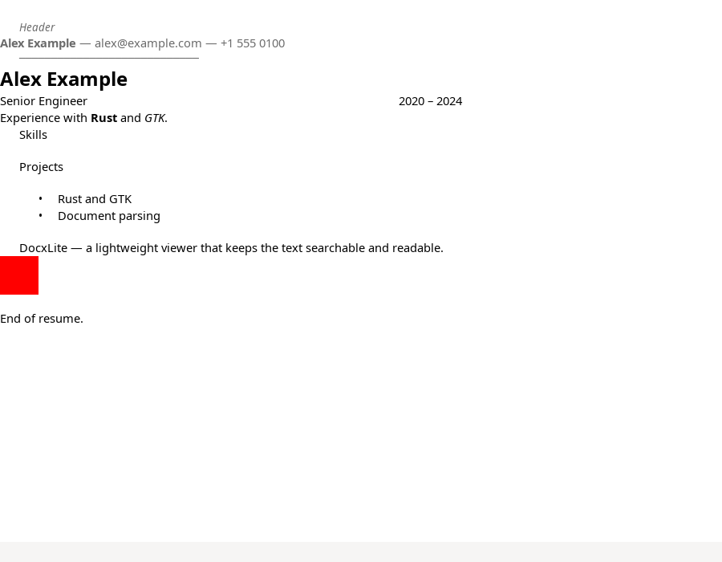

# DocxLite

A small, read-only `.docx` viewer for Ubuntu. It opens Word documents as readable, scrollable, searchable text — without launching LibreOffice or OnlyOffice.

**Working name:** `docxlite` is the development name. The public name is not final: `docxlite` is already used by an unrelated Python package, so rename the app/repo before publishing.



## What it does

- Opens `.docx`, `.docm` and `.dotx`.
- Renders headings, paragraphs, bold/italic/underline/strike, colours, highlighting, font sizes and common fonts.
- Renders bullet and numbered lists, including multilevel lists and Symbol/Wingdings bullets.
- Renders tables. Simple tables use aligned text columns; complex tables (multi-paragraph cells, merges, nested tables) fall back to a stacked reading order so text is never interleaved.
- Renders inline and anchored images, with alt-text placeholders for unsupported formats.
- Renders hyperlinks (click to open `http`, `https`, `mailto`; the real URL appears in the status bar on hover).
- Renders text boxes, headers and footers.
- Search (`Ctrl+F`), copy (`Ctrl+C`), zoom, drag-and-drop, open dialog, F5 reload, multiple windows.
- Follows the GTK theme; explicit document colours are honoured.

## What it deliberately does not do

- No editing, saving, printing or PDF export.
- No network access, telemetry, accounts, auto-update, recent-file list or config file.
- No macros, OLE activation, external templates or external image loading.
- No `.doc`, `.odt` or `.rtf` support. Old/password-protected documents get a friendly message.
- No pixel-faithful pagination, headers/footers per page, columns, comments pane, WordArt, charts or SmartArt. Unsupported content shows a placeholder or warning.

## Install

```bash
sudo apt install ./docxlite_*.deb
```

Uninstall:

```bash
sudo apt remove docxlite
```

The package does not force itself to be the default `.docx` handler. Use **Open With → Set as default** if you want that.

## Usage

```bash
docxlite FILE.docx
docxlite a.docx b.docx

# Headless text extraction (no GTK initialisation)
docxlite --dump-text FILE.docx
docxlite --dump-text --verbose FILE.docx
docxlite --dump-text --stats FILE.docx
```

Shortcuts:

| Key | Action |
|---|---|
| `Ctrl+O` | Open |
| `Ctrl+F` | Search |
| `Enter` / `Shift+Enter` | Next / previous match |
| `Esc` | Close search |
| `Ctrl+=` / `Ctrl++` | Zoom in |
| `Ctrl+-` | Zoom out |
| `Ctrl+0` | Reset zoom |
| `Ctrl+C` | Copy selection |
| `F5` | Reload |
| `Ctrl+W` / `Ctrl+Q` | Close / quit |

## Known limitations

- Table cell borders are not drawn in the text-first renderer. Shading is retained.
- A table is rendered as aligned text columns only when the whole table is simple. Otherwise it is rendered in stacked reading order (never interleaved columns).
- Exact/`atLeast` line spacing is approximated as a line-height factor; multiple line spacing is honoured.
- Headers and footers are rendered once at the top/bottom. Page-specific first/even variants are shown but not placed per page.
- Image decoding currently happens on the UI thread after bounded size checks. Very large image sets can still cost time.
- Comments, charts, SmartArt, OLE objects and WordArt are placeholders, not renderings.
- No page layout/pagination; this is a text reader, not a page-layout clone.

## Privacy and security

- Read-only: the document is never modified.
- Offline: no network sockets, image fetching, update checks or telemetry.
- XML DTDs are rejected; no external entities.
- Zip entries are never extracted to disk; declared sizes are not trusted.
- Links are opened only after an explicit click, and only for `http`, `https` and `mailto`.

See [SECURITY.md](SECURITY.md) for reporting.

## Build from source

Ubuntu 24.04+:

```bash
sudo apt install build-essential pkg-config libgtk-4-dev
cargo build --release
./target/release/docxlite
```

The crate uses GTK4 with the `v4_6` feature, so it builds against GTK 4.6+ and runs on newer Ubuntu releases. Rust 1.92+ is required by the current `gtk4` crate.

Run checks:

```bash
cargo fmt --check
cargo clippy --all-targets -- -D warnings
cargo test
cargo test --no-default-features
```

GUI smoke test (headless):

```bash
DOCXLITE_SMOKE_EXIT=1 xvfb-run -a \
  env GDK_BACKEND=x11 GSETTINGS_BACKEND=memory GTK_A11Y=none NO_AT_BRIDGE=1 \
  target/release/docxlite tests/fixtures/valid/basic.docx
```

## Measured size and resources

On Ubuntu 24.04, release build with the local GTK 4.14 runtime:

- Stripped binary: **833 KB**.
- `.deb`: **379 KB**, **880 KB installed**.
- Startup under Xvfb: **~0.12–0.27 s**.
- Peak RSS under Xvfb: **~137 MB with `GSK_RENDERER=cairo`**, ~213 MB with the default GL/llvmpipe renderer.
- The 80 MB RAM target from the specification is **not met** under Xvfb/llvmpipe; GTK4's baseline and Mesa dominate. Real desktop GPU numbers may differ. This is recorded as a known target miss, not hidden.

## Report a bug

Please include the Ubuntu version, whether you use Wayland or X11, and a description of the document structure. **Do not attach a private document to a public issue.** Reduce the problem to a small non-private fixture first, or contact the maintainer privately.

## License

MIT. See [LICENSE](LICENSE).
